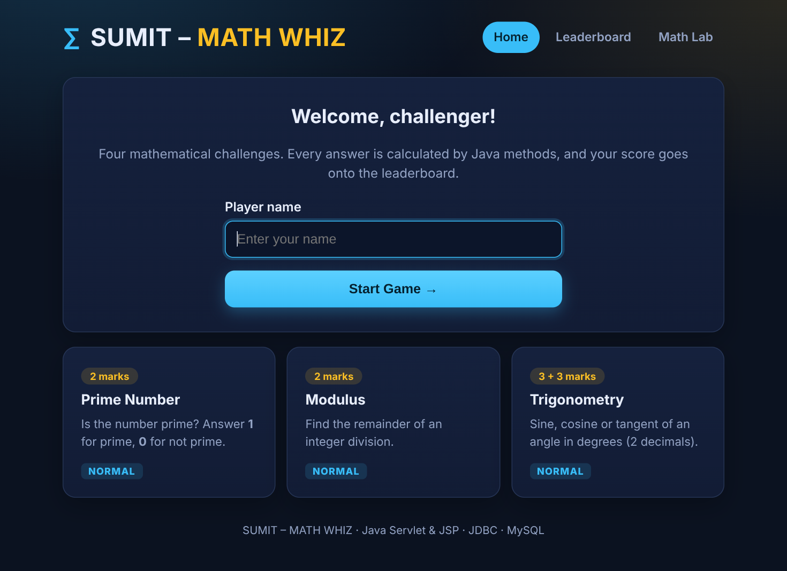
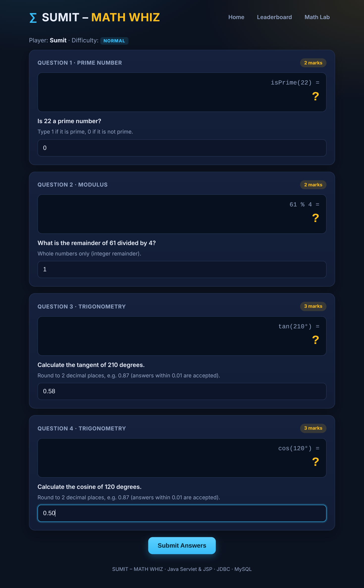
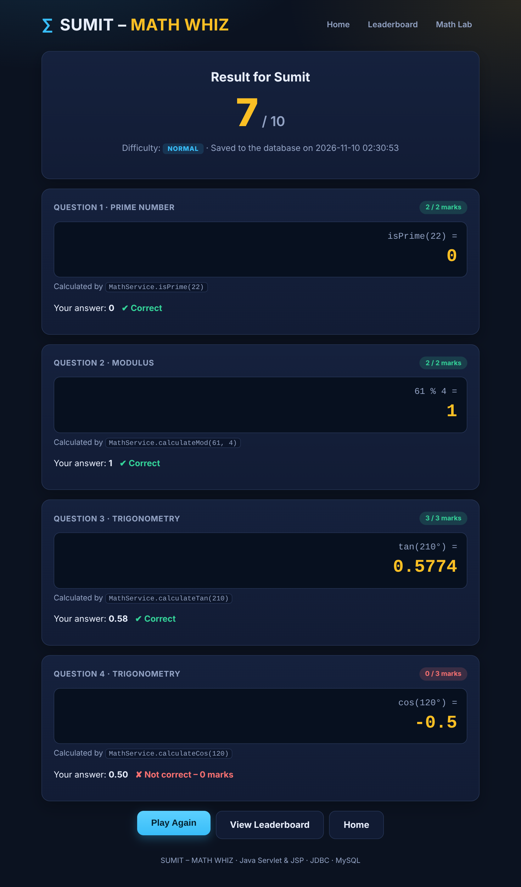
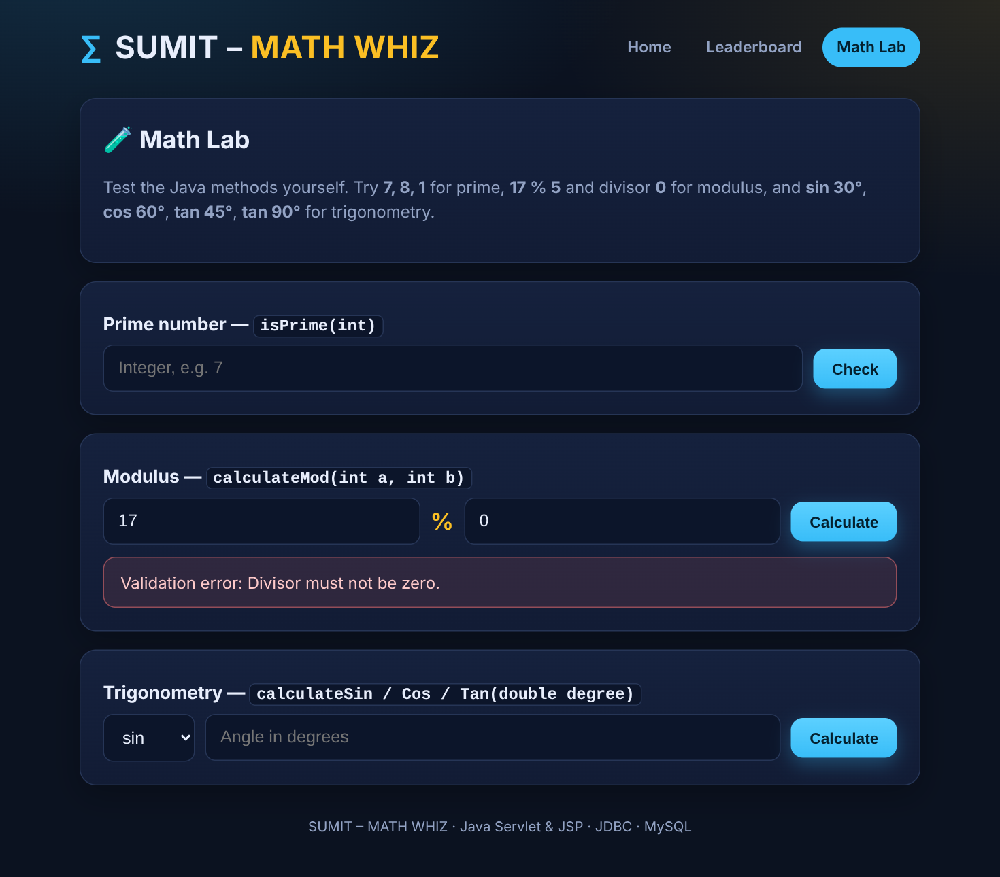

# ∑ SUMIT – MATH WHIZ

A web-based mathematical game built with **Java Servlets, JSP and JDBC (MySQL)**.
The player enters a name, answers four maths challenges, sees the final score and can view the **Top 10 leaderboard**.

> **Live project directory (GitHub):**
> https://github.com/sumitnoob/-web-based-mathematical-game-/tree/main/MathWhiz

---

## Project Objectives

- Build reusable Java methods for prime numbers, modulus and trigonometry.
- Apply conditional logic to evaluate answers and calculate a score out of 10.
- Understand Servlet request/response processing (Post/Redirect/Get, sessions, forwarding to JSP).
- Use **JDBC** with `PreparedStatement` to save and retrieve scores from MySQL.
- Show a sorted, limited result set (Top 10) in a web page.
- Document and submit a complete project on GitHub.

> **Important:** no answer is stored or hard-coded. Every correct answer is **calculated by a Java method when the player submits**
> (`MathService.isPrime`, `calculateMod`, `calculateSin`, `calculateCos`, `calculateTan`).
> The question numbers are kept in the server-side session, so the player cannot see or change them.

## Technologies Used

| Layer | Technology |
|---|---|
| Language | Java 17+ |
| Web | Jakarta Servlet 6.0, JSP 3.1 (Jakarta EE 10) |
| Server | Apache Tomcat 10.1 |
| Database | MySQL 8 + JDBC (MySQL Connector/J 8.4) |
| Build | Apache Maven (WAR packaging) |
| Testing | JUnit 5 |
| Front end | HTML5 + CSS3 (no frameworks) |

## Software Requirements

- JDK 17 or newer
- Apache Maven 3.8+ (or an IDE with Maven support: IntelliJ IDEA, Eclipse, NetBeans, VS Code)
- Apache Tomcat **10.1.x** (Jakarta namespace – *not* Tomcat 9)
- MySQL Server 8.x (and optionally MySQL Workbench)
- Any modern web browser

## Project Structure

```
MathWhiz/
├── pom.xml
├── database/
│   └── math_whiz_db.sql              # database + table creation script
├── src/main/java/
│   ├── controller/GameServlet.java   # Servlet: /game, /result, /leaderboard, /lab
│   ├── model/GameScore.java          # one row of game_scores
│   ├── model/GameState.java          # one running game (kept in the HTTP session)
│   ├── service/MathService.java      # isPrime, calculateMod, calculateSin/Cos/Tan, scoring
│   ├── service/GameService.java      # creates questions, validates + evaluates answers
│   ├── dao/DBConnection.java         # JDBC connection
│   ├── dao/ScoreDAO.java             # INSERT / SELECT with PreparedStatement
│   └── util/Html.java                # escapes text printed into pages
├── src/main/resources/db.properties  # JDBC url, user, password
├── src/main/webapp/
│   ├── index.jsp                     # Screen 1 – Welcome
│   ├── game.jsp                      # Screen 2 – Game (4 questions)
│   ├── result.jsp                    # Screen 3 – Result
│   ├── leaderboard.jsp               # Screen 4 – Top 10
│   ├── lab.jsp                       # Math Lab – try the methods yourself
│   ├── error.jsp
│   ├── css/style.css
│   └── WEB-INF/ (web.xml, jspf/header.jspf, jspf/footer.jspf)
├── src/test/java/service/            # JUnit tests (MathServiceTest, GameServiceTest)
├── screenshots/
└── README.md
```

## Database Configuration

The application connects with the settings in `src/main/resources/db.properties`:

```properties
db.driver=com.mysql.cj.jdbc.Driver
db.url=jdbc:mysql://localhost:3306/math_whiz_db?useSSL=false&allowPublicKeyRetrieval=true
db.user=root
db.password=12345678
```

Change `db.user` / `db.password` to match **your** MySQL account.
(For safety on a public repository, replace the password with a placeholder before pushing, or use the environment
variables `DB_URL`, `DB_USER`, `DB_PASSWORD`, which override the file.)

## Database Creation SQL

File: [`database/math_whiz_db.sql`](database/math_whiz_db.sql)

```sql
CREATE DATABASE IF NOT EXISTS math_whiz_db
    CHARACTER SET utf8mb4
    COLLATE utf8mb4_unicode_ci;

USE math_whiz_db;

CREATE TABLE IF NOT EXISTS game_scores (
    id          INT          NOT NULL AUTO_INCREMENT,
    player_name VARCHAR(100) NOT NULL,
    score       INT          NOT NULL,
    difficulty  VARCHAR(20)  NOT NULL DEFAULT 'NORMAL',
    played_at   TIMESTAMP    NOT NULL DEFAULT CURRENT_TIMESTAMP,
    PRIMARY KEY (id)
);
```

Leaderboard query used by the application (tie-break: earlier date/time first):

```sql
SELECT id, player_name, score, difficulty, played_at
FROM game_scores
ORDER BY score DESC, played_at ASC, id ASC
LIMIT 10;
```

## Steps to Run the Application

1. **Create the database** (once):
   ```bash
   mysql -u root -p < database/math_whiz_db.sql
   ```
   (or open the file in MySQL Workbench and run it).
2. **Check `src/main/resources/db.properties`** – user and password must match your MySQL.
3. **Build the WAR file:**
   ```bash
   mvn clean package
   ```
   This also runs the unit tests and creates `target/MathWhiz.war`.
4. **Deploy to Tomcat 10.1:** copy `target/MathWhiz.war` into `<TOMCAT_HOME>/webapps/` and start Tomcat
   (`bin/startup.bat` on Windows, `bin/startup.sh` on Linux/macOS).
5. **Open the game:** <http://localhost:8080/MathWhiz/>

**Using an IDE instead (IntelliJ IDEA / Eclipse):** open the folder as a Maven project, add a *Tomcat 10.1* run
configuration, deploy the `MathWhiz:war exploded` artifact and start it. The application context path is `/MathWhiz`.

### Run the unit tests only
```bash
mvn test
```

### Troubleshooting

| Problem | Fix |
|---|---|
| Pages give HTTP 404 / `ClassNotFoundException: javax.servlet...` | You are on Tomcat 9. Use **Tomcat 10.1** (this project uses `jakarta.servlet`). |
| “Your score could not be saved… Access denied” | Wrong MySQL user/password in `db.properties`. |
| “Unknown database 'math_whiz_db'” | Run `database/math_whiz_db.sql` first. |
| “Communications link failure” | MySQL is not running or is not on port 3306. |

## Game Rules and Scoring System

The game always generates **four questions: one prime, one modulus and two trigonometric**. Difficulty is **NORMAL** for every
question and is saved in the database with each score.

| Question | Mathematical area | Player answers | Marks |
|---|---|---|---|
| Q1 | Prime number | `1` if prime, `0` if not prime | 2 |
| Q2 | Modulus (`a % b`, integers only, divisor never 0) | the integer remainder | 2 |
| Q3 | Trigonometry (sin / cos / tan) | decimal value, 2 decimal places | 3 |
| Q4 | Trigonometry (a different function from Q3) | decimal value, 2 decimal places | 3 |
| | | **Total** | **10** |

- **Prime:** returns `1` for a prime, otherwise `0`; numbers less than 2 are not prime.
- **Modulus:** uses Java's `%` operator. A zero divisor is rejected (`IllegalArgumentException` → *Validation error*).
- **Trigonometry:** angles are in **degrees**, converted with `Math.toRadians()` and calculated with `Math.sin/cos/tan`.
  Tangent at 90°, 270°… is *undefined* and is never asked (and is reported as undefined in the Math Lab).
  Decimal answers are accepted when they are within **±0.01** of the real value.
- **Score:**
  ```java
  int totalScore = 0;
  if (primeCorrect) totalScore += 2;
  if (modCorrect)   totalScore += 2;
  if (trig1Correct) totalScore += 3;
  if (trig2Correct) totalScore += 3;
  ```
- Answers that are empty or not numbers are rejected with a message before anything is scored or saved.
- The score is saved once per game (refreshing or re-submitting never creates a duplicate row).

## Testing and Validation (Task 09)

All of these are automated in `src/test/java/service` (24 JUnit tests) and can also be tried by hand on the **Math Lab** page
(`/MathWhiz/lab`). The whole web flow was also tested end-to-end against a running Tomcat + database.

| Test case | Expected result | Result |
|---|---|---|
| Prime input: 7 | 1 | ✅ Pass |
| Prime input: 8 | 0 | ✅ Pass |
| Prime input: 1 | 0 | ✅ Pass |
| Modulus: 17 % 5 | 2 | ✅ Pass |
| Sine: 30° | 0.5 | ✅ Pass |
| Cosine: 60° | 0.5 | ✅ Pass |
| Tangent: 45° | 1.0 | ✅ Pass |
| Divisor: 0 | Validation error | ✅ Pass |
| Tangent: 90° | Undefined (error) | ✅ Pass |
| All answers correct | Maximum 10 marks | ✅ Pass |
| Incorrect answers | Corresponding marks not awarded | ✅ Pass |

## Application Screenshots

### Welcome Page


### Game Page


### Result Page


### Leaderboard


### Math Lab (testing the Java methods, including the divisor-0 validation error)


## GitHub Project Directory

https://github.com/sumitnoob/-web-based-mathematical-game-/tree/main/MathWhiz

---
*Author: Sumit — Java Web Application Development, Live Lab Test #2.*
